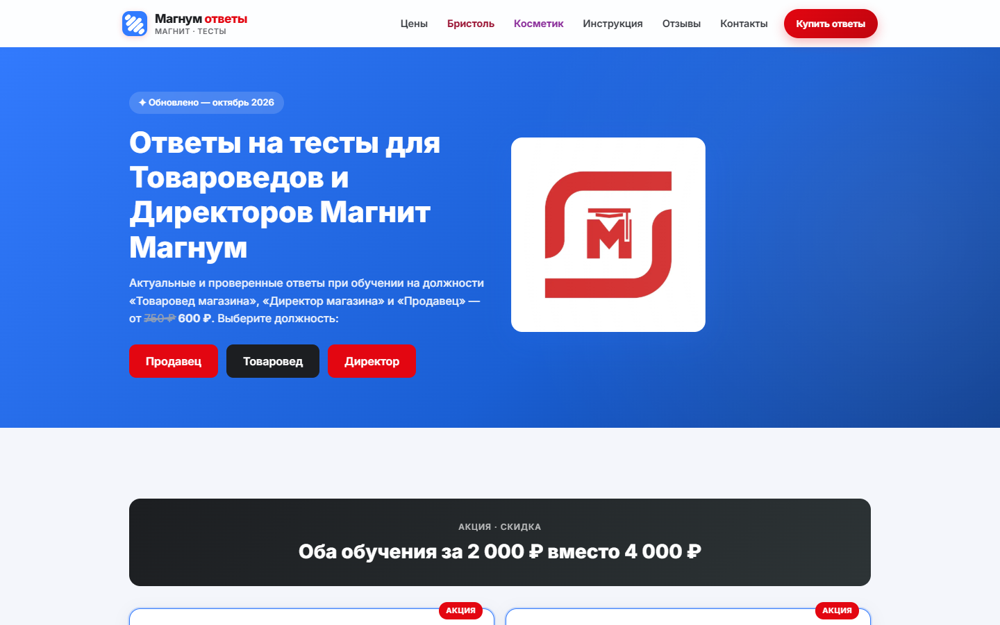
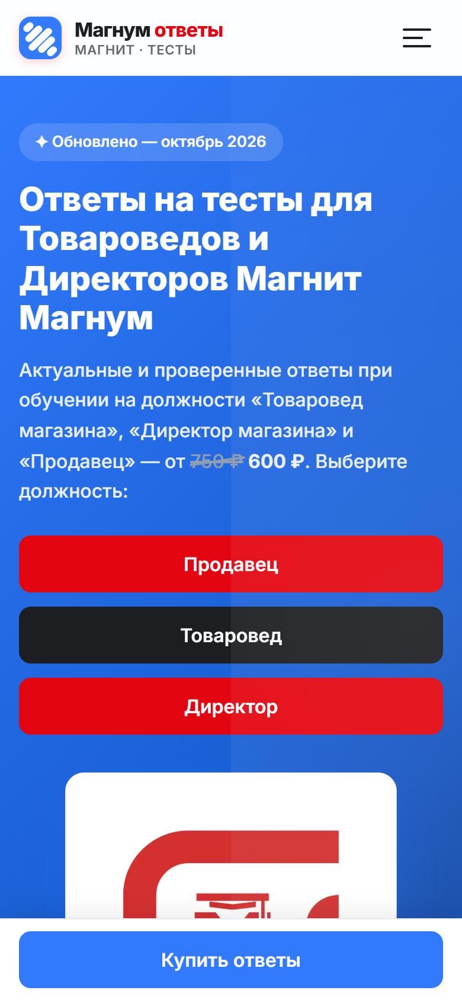
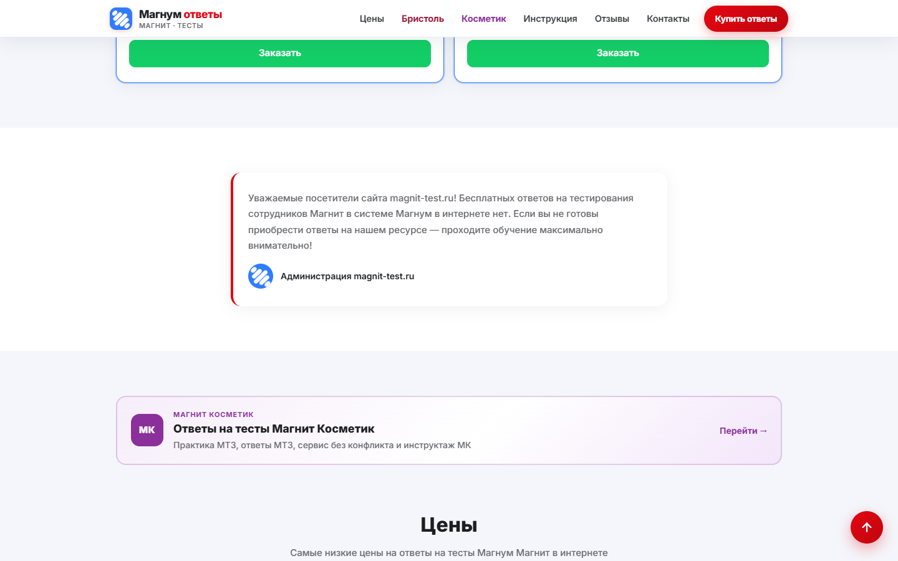

# Magnit-Test — showcase

| | |
|--|--|
| 🌐 Live | https://www.magnit-test.ru/ |
| Status | **In production / в проде** |

## Скриншоты / Screenshots





---

## 🇷🇺 Русский

### О проекте
Платный портал **ответов на тесты Магнит Магнум** (товаровед / директор): лендинг, оплата, **временный доступ** с поиском.  
Тот же продуктовый паттерн, что Bristol-Test; **общий webhook ЮKassa** (маршрутизация по `metadata`).

### Что сделано
- Лендинг и демо-превью ответов
- Оплата **ЮKassa** + webhook + success
- Токены доступа, view/check
- Уведомления Telegram
- Связка с bristol-test
- SEO / verification

### Стек: что за что

| Часть | Технологии | Для чего |
|--------|------------|----------|
| Витрина | PHP (`index.php`, demo-страницы) | Продажа доступа, SEO |
| UI | CSS, JS | Интерфейс покупки и просмотра |
| Оплата | PHP + **ЮKassa** | `buy.php`, `webhook.php`, `success.php` |
| Доступ | PHP | `access.php`, `view.php`, `check.php`, demo |
| API | `api/` | Токены, служебные вызовы |
| Конфиг | `includes/` (placeholders) | site, DB, ЮKassa, Telegram |
| SEO | robots, sitemap | Органика |

### Поток
```
Лендинг → оплата → webhook (metadata product/site) → токен → view → TG admin
```

### Код
Коммерческий проект: исходный код закрыт и хранится в приватном репозитории. Здесь — описание, стек и скриншоты.

---

## 🇬🇧 English

### About
Paid portal for **Magnit Magnum test answers** (category manager / store director roles): landing, checkout, **time-limited searchable access**.  
Same product pattern as Bristol-Test; **shared YooKassa webhook** routed by payment `metadata`.

### What was built
- Landing + demo previews
- **YooKassa** payment + webhook + success
- Access tokens and content view
- Telegram admin alerts
- Cross-link with bristol-test
- SEO / site verification

### Stack: what each layer is for

| Layer | Tech | Purpose |
|--------|------|---------|
| Storefront | PHP (`index.php`, demos) | Sell access, SEO |
| UI | CSS, JS | Purchase & reading UX |
| Payments | PHP + **YooKassa** | Checkout, webhook, return |
| Access | PHP | Tokens, view, session checks |
| API | `api/` | Token issue, helpers |
| Config | `includes/` (placeholders) | Site, DB, YooKassa, Telegram |
| SEO | robots, sitemap | Organic traffic |

### Flow
```
Landing → pay → webhook (metadata) → token → view → Telegram notify
```

### Code
Commercial project: the source is private. This repository is a showcase — overview, stack and screenshots.

---

**Author:** [Ruslan Kovalchuk](https://github.com/Arctillect-RK) · [Telegram](https://t.me/Arctillect)
